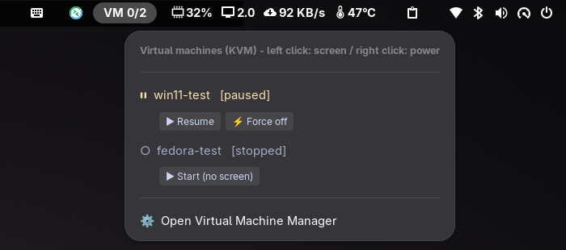
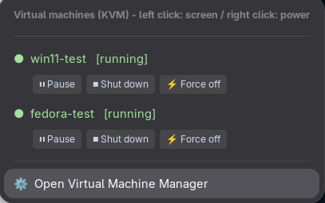
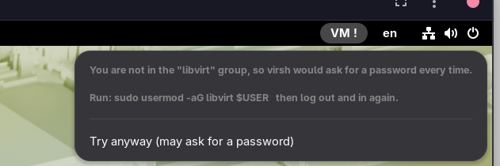

# VM Selector

[English](README.md)

トップバーから KVM（libvirt）の仮想マシンを選んで、全画面で接続する GNOME Shell 拡張です。



- トップバーに `VM 実行中の数/全部の数`（例: `VM 1/3`）を出します（5 秒ごとに更新）。
- クリックすると、VM の一覧が出ます。
  - **左クリック**: その VM の画面に、`virt-viewer` で接続します（全画面）。
    - 停止中なら、起動してから接続します。
    - 一時停止中なら、再開してから接続します。
    - すでにその VM の窓が開いていれば、新しく開かずに、その窓を前に出します。
  - **右クリック**: 電源の操作（一時停止・再開・シャットダウン・強制停止・起動）を出します。
- 一覧の最後に、Virtual Machine Manager（`virt-manager`）を開く項目があります。

### 電源の操作（右クリック）

VM を右クリックすると、その下に電源のボタンが出ます（もう一度右クリックすると隠れます）。ボタンは、VM の状態によって変わります。



| 状態 | ボタン |
|---|---|
| 実行中 | Pause（一時停止）、Shut down（シャットダウン）、Force off（強制停止） |
| 一時停止中 | Resume（再開）、Force off |
| 停止中 | Start (no screen)（画面なしで起動） |

- **Pause** は、VM を止めます（`virsh suspend`）。メモリに残ったままで、**Resume** で続きから動きます。
- **Shut down** は、ゲスト OS に電源を切るよう頼みます（`virsh shutdown`）。
- **Force off** は、すぐに電源を切ります（`virsh destroy`）。ゲストの保存していないデータは失われます。
- **Start (no screen)** は、窓を開かずに VM を起動します。左クリックなら、起動して画面も開きます。

## なぜ作ったか

Wayland の GNOME では、`virt-manager` の画面に入っていても、Super キーや Alt+Tab がホスト側に取られることがあります。独立した SPICE クライアントの `virt-viewer` を全画面で使うと、キーを VM に渡しやすくなります。この拡張は、その `virt-viewer` を、トップバーから 1 クリックで開くためのものです。

## 動作条件

- GNOME Shell 50（`metadata.json` の `shell-version`。ほかのバージョンでは試していません）
- libvirt（`qemu:///system` に接続します）と、`virsh`
- `virt-viewer` と `virt-manager`
- 使うユーザーが `qemu:///system` を操作できること（ふつうは `libvirt` グループに入っていること）

先に、パッケージを入れます。

| ディストリ | コマンド | 確認 |
|---|---|---|
| Fedora | `sudo dnf install libvirt-client virt-viewer virt-manager` | 確認済み（`virsh` は最初から入っていました） |
| Ubuntu / Debian | `sudo apt install libvirt-clients libvirt-daemon-system virt-viewer virt-manager` | パッケージ名は未確認 |
| Arch | `sudo pacman -S libvirt virt-viewer virt-manager` | パッケージ名は未確認 |
| NixOS | `virtualisation.libvirtd.enable = true;` と `pkgs.virt-viewer`・`pkgs.virt-manager` | 確認済み |

## インストール（手動）

先に、`libvirt` グループに入って、ログインし直します（入っていないと、トップバーに `VM !` が出ます）。

```bash
sudo usermod -aG libvirt $USER
```

そのあとで、次を実行します。

```bash
git clone https://github.com/yoohey/gnome-shell-vm-selector.git
mkdir -p ~/.local/share/gnome-shell/extensions/vm-selector@yoohey
cp gnome-shell-vm-selector/{metadata.json,extension.js,stylesheet.css} \
   ~/.local/share/gnome-shell/extensions/vm-selector@yoohey/
```

ログアウトして、ログインし直してから（GNOME Shell が新しい拡張を見つけるため）、有効にします。

```bash
gnome-extensions enable vm-selector@yoohey
```

## `libvirt` グループに入っていないとき

グループに入っていないと、`virsh` を呼ぶたびに polkit がパスワードを求めます。そのため、拡張は背景での問い合わせをしません。トップバーに `VM !` が出て、メニューに対処が出ます。



- `sudo usermod -aG libvirt $USER` を実行して、ログインし直す。または
- **Try anyway** を押して、1 回だけ問い合わせる。うまくいけば（VM が 0 台でも）、通常の更新が始まります。

## うまくいかないとき

| 症状 | 確かめること |
|---|---|
| トップバーに出ない | ファイルをコピーしたあと、ログインし直しましたか。`gnome-extensions info vm-selector@yoohey` が `State: ACTIVE`（または `ENABLED`）になっているか。 |
| `VM !` | `libvirt` グループに入っていません（上の節）。`id -Gn` で、今のセッションのグループが分かります。 |
| VM があるのに `VM 0/0` | 拡張は `qemu:///system` に接続します。`qemu:///session` で作った VM（GNOME Boxes など）は出ません。`virsh -c qemu:///system list --all` で確かめます。 |
| VM をクリックしても何も起きない | `virt-viewer` が入っているか（`virt-viewer --version`）。 |
| それ以外 | Shell のログを見ます: `journalctl --user -b \| grep -i vm-selector`、または `journalctl -f -o cat /usr/bin/gnome-shell` を流して、再現させます。 |

## しくみ

コマンドは、シェルを通さず、引数の配列として非同期に実行します。場所は PATH から探します。

| 何を | コマンド |
|---|---|
| VM の一覧 | `virsh -c qemu:///system list --all --name` |
| VM の状態 | `virsh -c qemu:///system domstate 名前` |
| 電源の操作 | `virsh -c qemu:///system start / suspend / resume / shutdown / destroy 名前` |
| 接続 | `virt-viewer -c qemu:///system -f 名前`（起動中の VM には `-w` を足します） |
| マネージャーを開く | `virt-manager` |

問い合わせを始める前に、`libvirt`（または `libvirtd`）グループに入っているかを確かめます（`id -Gn`）。

## 既知の制限

- NixOS（GNOME Shell 50.5）と Fedora Workstation（GNOME Shell 50.0）で確認しました。コマンドは PATH から探すので、Ubuntu などでも動くはずですが、確認していません。
- 接続先は `qemu:///system` で固定です。
- 画面の文字は英語だけです。

## ライセンス

MIT（`LICENSE`）。
